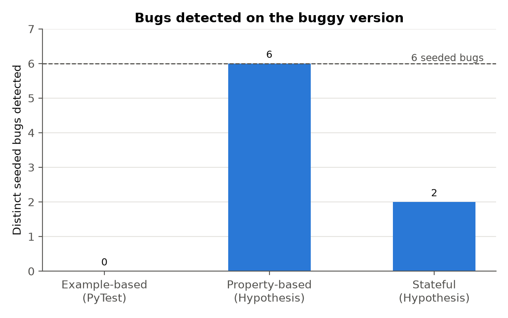

# Presentation Notes

Everything you need to explain and present the project. All numbers below come from the
actual run in [`results/metrics.json`](../results/metrics.json) (seed 12345).

---

## 1. Results summary

| Version | Suite | Passed / Failed | Test cases run | Bugs detected | Time |
|---|---|---|---|---|---|
| Buggy | Example-based (15 tests) | 15 / 0 | 15 | none | 0.14 s |
| Buggy | Property-based (10 properties) | 1 / 9 | 1,221 | BUG-1 to BUG-6 (all 6) | 1.84 s |
| Buggy | Stateful (1 state machine) | 0 / 1 | 54 | BUG-1, BUG-3 | 0.45 s |
| Fixed | Example-based | 15 / 0 | 15 | none | 0.03 s |
| Fixed | Property-based | 10 / 0 | 2,100 | none | 0.98 s |
| Fixed | Stateful | 1 / 0 | 200 programs | none | 0.69 s |

**The three claims, all verified by `scripts/run_experiment.py`:**
1. Example-based tests all pass on the buggy version → they detect **0 of 6** bugs.
2. Property-based + stateful tests detect **6 of 6** bugs.
3. Everything passes on the fixed version.

The one property that passes on buggy (P-06, "overdraft of ₹1 or more is rejected") is a deliberate
**control**. It shows that properties don't simply fail by default.

### Shrunk counterexamples from the run

| Property | Bug | Hypothesis's minimal failing input | What happened |
|---|---|---|---|
| P-01 round trip | BUG-1 | start=0.01, amount=0.02 | balance became 0.009999999999999998 |
| P-02 two decimal places | BUG-1 | deposits=[0.01, 2.01] | balance became 2.0199999999999996 |
| P-03 deposit ≤ 0 rejected | BUG-6 | start=0.00, amount=0.00 | deposit(0) accepted, no ValueError |
| P-04 negative withdraw rejected | BUG-2 | start=0.00, amount=-0.01 | withdraw(-0.01) accepted |
| P-05 never negative | BUG-3 | start=0.00, amount=0.01 | balance became −0.01 |
| P-07 interest never decreases | BUG-5 | start=0.37, rate=-2.71 | balance dropped to 0.36 |
| P-08 interest rounding | BUG-5 | start=0.36, rate=1.39 | got 0.36, expected 0.37 (truncated) |
| P-09 transfer conserves total | BUG-4 | balances=[0,0,0.01], sender=2, receiver=2, amount=0.01 | total went 0.01 → 0.02 |
| P-10 self-transfer | BUG-4 | start=0.01, amount=0.01 | balance went 0.01 → 0.02 |
| S-01 stateful | BUG-3 | `withdraw(ACC0, 0.01)` on an empty account | balance −0.01 |
| S-01 stateful | BUG-1 | `deposit(0.01)` → `deposit(3.01)` | 3.0199999999999996 instead of 3.02 |

---

## 2. The 2-minute explanation (say this out loud)

> Most unit tests are example-based: I pick an input, work out the answer, and assert it. The problem
> is that those tests only check the cases I thought of, and my blind spots in the tests are usually
> the same as my blind spots in the code.
>
> To show this, I built a small banking module with deposit, withdraw, transfer and interest, and I
> put six realistic bugs into it. For example, money is stored as a float, you can withdraw a negative
> amount, the overdraft check compares only whole rupees, and transferring money to your own account
> creates money. Then I wrote 15 normal PyTest tests, the kind any of us would write: deposit 100,
> withdraw 50, transfer 30. All 15 pass. By normal standards, this code is done.
>
> Then I used property-based testing with Hypothesis. Instead of examples, I write rules that must
> always hold: a transfer never changes the bank's total money, a balance is never negative,
> depositing and withdrawing the same amount is a round trip. Hypothesis generates hundreds of inputs
> for each rule and leans towards edge cases like zero, 0.01 and boundaries. Nine of my ten properties
> failed, and together they caught all six bugs. The tenth is a control that's supposed to pass.
>
> The best part is shrinking. When Hypothesis finds a failure, it simplifies the input until it has
> the smallest case that still fails. So instead of a random amount like 7,318.64, it told me:
> balance 0.00, withdraw 0.01, and the balance becomes minus 0.01. From that, the bug is obvious. I also
> wrote a stateful test that runs random sequences of deposits, withdrawals and transfers and checks
> invariants after every step. It shrank a 20-step failure down to one or two steps.
>
> After fixing the bugs, using Decimal for money and rejecting invalid input, all 26 tests pass. On
> the fixed version Hypothesis ran over 2,000 generated cases, against 15 hand-written ones. The
> lesson is that passing tests only prove the code works for the inputs you tried. Property-based
> testing lets the machine search for the inputs you didn't think of, and it works best alongside
> normal example tests, not as a replacement.

---

## 3. Walkthrough of the code (what each file does)

| File | What to say about it |
|---|---|
| `src/bank_buggy.py` | The module with 6 seeded bugs. The comment block at the top lists each bug, why example tests miss it, and which property catches it. |
| `src/bank_fixed.py` | Same API. Money is `Decimal` rounded to 2 places (`to_money()`), every bad input raises `ValueError`, and `transfer()` is just `withdraw()` then `deposit()`, so it can't create money. |
| `src/bank.py` | Picks buggy or fixed from the `BANK_VERSION` env variable, so the **same tests** run on both. |
| `tests/test_example_based.py` | 15 normal PyTest tests. They all pass on the buggy code, which is the point. |
| `tests/test_property_based.py` | 10 properties. Each one has `@given(...)` with strategies such as `st.decimals(places=2)` and a docstring stating the rule in plain English. |
| `tests/test_stateful.py` | A `RuleBasedStateMachine` with rules (deposit / withdraw / transfer), a model dict of expected balances, and invariants checked after every step. |
| `tests/conftest.py` | Turns off Hypothesis's deadline and example database so runs are reproducible from the seed. |
| `scripts/run_experiment.py` | Runs 3 suites × 2 versions, parses pytest's JUnit XML and Hypothesis's statistics, maps failures to bug IDs, and writes `results/metrics.json`. |
| `scripts/make_charts.py` | Draws the 4 charts and the workflow diagram from `metrics.json`. |
| `report/build_report.py` | Builds the Word report from `metrics.json` and the source code, so no number is typed by hand. |

### The bugs, with the exact buggy line

| Bug | Buggy code | Fix |
|---|---|---|
| BUG-1 | `self.balance = float(balance)` | `Decimal`, quantized to `0.01` |
| BUG-2 | no `amount <= 0` check in `withdraw()` | `if amount <= 0: raise ValueError` |
| BUG-3 | `if int(amount) > int(self.balance):` | `if amount > self.balance:` |
| BUG-4 | computes `new_from_balance` and `new_to_balance`, then assigns both | reject `to_account is self`; withdraw then deposit |
| BUG-5 | `interest = int(self.balance * rate) / 100` | reject `rate < 0`; `quantize(CENT, ROUND_HALF_UP)` |
| BUG-6 | no check in `deposit()` | `if amount <= 0: raise ValueError` |

---

## 4. Key concepts in one line each

- **Property**: a rule that must hold for *every* valid input.
- **Strategy**: a description of which inputs to generate (`st.decimals`, `st.integers`, `st.lists`, ...).
- **`@given`**: turns a test into a property; Hypothesis calls it many times with generated inputs.
- **`@settings`**: controls the run (e.g. `max_examples=200`).
- **`@example`**: an input that is always tried first (used in P-05 for the 100-from-100 boundary).
- **Shrinking**: simplifying a failing input to the smallest one that still fails.
- **Stateful testing**: generating random *sequences* of operations and checking invariants after each step.
- **Invariant**: something that must always stay true (no negative balance, total money conserved).
- **Seed**: `--hypothesis-seed=12345` makes the random inputs identical on every run.

---

## 5. Viva questions and answers

**Q1. What is a property?**
A rule that must be true for every valid input, for example "a transfer never changes the bank's total money". It describes behaviour in general instead of one example.

**Q2. What is property-based testing?**
A testing style where you write properties and a tool generates many inputs automatically to try to break them. If an input breaks a property, the tool reports it as a counterexample.

**Q3. What is Hypothesis?**
The main property-based testing library for Python. It works as a pytest plugin. You decorate a test with `@given(...)` and it calls the test with generated inputs.

**Q4. What is a strategy?**
A description of which inputs to generate, for example `st.decimals(min_value=0, max_value=10000, places=2)` for money amounts. Strategies can be combined, for example a list of decimals.

**Q5. What is shrinking?**
When Hypothesis finds a failing input, it keeps trying simpler versions (smaller numbers, shorter lists, fewer steps) and keeps the simplest one that still fails. In this project a failing withdrawal was shrunk to balance 0.00, amount 0.01.

**Q6. Why did the example-based tests pass on the buggy code?**
They only use inputs like 100, 50 and 10.50, which avoid every bug: they never use negative amounts, never transfer to the same account, never overdraw by less than a rupee, and use amounts that are exact in binary floating point.

**Q7. How is PBT different from random testing?**
Random testing usually just checks that nothing crashes. PBT checks a meaningful rule. It biases generation towards edge cases like 0 and boundaries, and it shrinks failures to minimal examples instead of reporting a large random input.

**Q8. How is it different from boundary value analysis?**
In BVA the tester must find the boundaries by hand. With PBT the tool searches the whole range and favours boundary-like values automatically, so it can find boundaries the tester did not know about, such as the paise just above the balance in BUG-3.

**Q9. What is stateful testing?**
Testing a sequence of operations instead of a single call. Hypothesis's `RuleBasedStateMachine` generates random sequences of rules (deposit, withdraw, transfer), checks invariants after each step and shrinks a failing sequence to the shortest one.

**Q10. What is an invariant?**
A condition that must stay true at all times, such as "no balance is ever negative" or "the total money equals deposits minus withdrawals".

**Q11. Why is float wrong for money?**
Binary floating point cannot represent most decimal fractions exactly, so 0.1 + 0.2 = 0.30000000000000004. The fixed version uses `decimal.Decimal` rounded to 2 places.

**Q12. How did you make random tests reproducible?**
By fixing the seed with `--hypothesis-seed=12345` and disabling the example database, so every run generates the same inputs.

**Q13. What are `@settings` and `@example`?**
`@settings` changes how Hypothesis runs, for example `max_examples=200`. `@example` adds a specific input that is always tested in addition to the generated ones.

**Q14. Does PBT replace example-based tests?**
No. They complement each other. Examples are clear documentation and regression tests. Properties find the unexpected cases.

**Q15. What are the limitations of PBT?**
You must think of good properties, a weak property gives false confidence, tests take longer, and it still cannot prove that there are no bugs.

**Q16. What is the Hypothesis example database?**
A local store (the `.hypothesis` folder) of failing inputs. Hypothesis replays them first on the next run so a bug is not lost. It was disabled in this project only to keep runs reproducible from the seed.

**Q17. Why did the state machine not report BUG-4?**
Self-transfer and float drift both break the same assertion (total money conserved). Hypothesis reports one failure per assertion and chose the simpler one. BUG-4 was still caught by the dedicated self-transfer property (P-10).

**Q18. Why are there so many "examples" on a property that failed immediately (e.g. 298 for P-03)?**
Most of them come from Hypothesis's *explain* phase. After shrinking, it re-runs the failure while varying each argument, to tell you which arguments don't matter. That's why the output says `# or any other generated value`.

**Q19. Couldn't a careful tester have found these bugs by hand?**
Some of them, yes, with careful boundary value analysis. The point is that PBT doesn't depend on that care: one rule written once covers thousands of inputs, including cases the tester didn't think of. The report says this openly in its limitations section.
